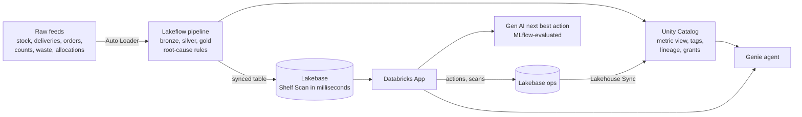

# Larkwell Shelf Availability

**A large UK food retailer starts every morning with about 206,000 empty or low shelves across 900 stores. About £1.09m of
that day's sales is at risk on the ones it can fix. This prototype does three things before the doors open:**
- **finds the root cause of every one;**
- **puts the cause and the next action in a store colleague's hand, in milliseconds, at the shelf;**
- **tracks what got done, so head office sees the loop close.**

> Larkwell Foods is fictitious, and every record here is synthetic. The problem and the scale are typical of a large UK food
> retailer. No customer data, names or branding are used.

## Business outcome

The business deck is [deck/larkwell_shelf_availability_deck.pdf](deck/larkwell_shelf_availability_deck.pdf); the same deck as text, with speaker notes, is [deck/deck.md](deck/deck.md).
Estimates use this build's data and the assumptions in [docs/value_model.md](docs/value_model.md).

| For | KPI | Today (from the data) | With this build |
|---|---|---|---|
| **Chief Operating Officer** (executive sponsor) | Controllable lost sales | £158m a year | **£15.8m-£39.5m a year recovered** (base case £23.7m) |
| | Store time spent finding out why a shelf is empty | about 900 hours a day across the estate | **about 328,000 hours (£4.3m) a year given back** |
| | Run cost | | roughly £40k-£90k a year, indicative |
| **Head of Availability** (domain owner) | Gaps and lows with a confirmed root cause | manual, the next day | **98.0%, automatically, every morning** |
| | From morning snapshot to action at the shelf | the next day's report | **minutes**; every action is logged and visible to head office |
| | Supplier and depot accountability | anecdotal | Oldcastle Confectionery runs a **59% fill rate** against a 99.0% contract; Merseyvale DC has **6,078 blocked lines across 130 stores** |

## One connected journey



| Stage | How it's done here |
|---|---|
| **Lakeflow** ingest | Ten raw feeds (CSV and JSON) land in a Unity Catalog volume each day.<br/>A Spark Declarative Pipeline ingests them incrementally (Auto Loader), types and de-duplicates them, and enforces 38 data-quality expectations.<br/>Gold works out every shelf's status and root cause from the raw signals.<br/>A Lakeflow Job runs the whole day end to end. |
| **Unity Catalog** governance | Medallion schemas and governed tags (email tagged `pii`).<br/>Lineage is automatic, and the app has least-privilege grants: it can't write to the lakehouse at all.<br/>A **metric view** holds the one definition of availability, gap rate, attribution and sales at risk. |
| **Lakebase** serving | Gold is synced into Postgres: Shelf Scan does a primary-key lookup in a few milliseconds, against about half a second on the warehouse: over 100 times faster.<br/>The app writes colleague actions, scans, AI recommendations and feedback to Postgres.<br/>**Lakehouse Sync** streams every change back into Unity Catalog. |
| **Gen AI** | An LLM words the playbook action for the colleague. It never decides the cause or a number.<br/>An MLflow GenAI evaluation of the app's own prompt runs on 48 real cases every day: six code checks and two LLM judges.<br/>The judges run on a different model family, and must agree with 19 hand-labelled answers before they're trusted. |
| **Genie agent** | Plain-English questions over the metric view, gold, supplier performance and the actions views.<br/>Benchmarked 12/12 with Genie's evaluation. |
| **Databricks App** | Dashboards and drill-downs by persona, a morning briefing, Shelf Scan with action buttons, Genie chat, and a live **Data Journey** tab that shows every stage's numbers. |

More detail: [docs/architecture.md](docs/architecture.md).

## Proof it ran

Everything in `evidence/` is text, regenerated from the live workspace by `scripts/collect_evidence.py`. The app test output is captured from `scripts/e2e_test.py`.

| Evidence | Headline |
|---|---|
| [01_raw_feeds.md](evidence/01_raw_feeds.md) | 6.26M rows in 23 files per trading day, with each day's manifest and answer key |
| [02_lakeflow_pipeline.md](evidence/02_lakeflow_pipeline.md) | Pipeline updates, rows written per dataset, and all 38 expectations. On day two Auto Loader ingested only the new day's files |
| [03_pipeline_checks.md](evidence/03_pipeline_checks.md) | **40 of 40 checks passed** on the latest trading day, as on day one. 205,834 of 205,834 gaps and lows match the answer key exactly.<br/>The day-two runs show the two bugs the checks caught, and a repair whose pass doesn't count |
| [04_unity_catalog_governance.md](evidence/04_unity_catalog_governance.md) | Governed tags, the app's least-privilege grants, automatic lineage, and KPIs from the metric view |
| [05_lakebase_serving_and_sync.md](evidence/05_lakebase_serving_and_sync.md) | 5.4M rows synced to Postgres, Shelf Scan lookup times by serving path, and Lakehouse Sync history |
| [06_genie_benchmark.md](evidence/06_genie_benchmark.md) | Genie benchmark: 11, 11, then **12 of 12**, with what was changed and why |
| [07_app_e2e_test.txt](evidence/07_app_e2e_test.txt) | **65 of 65 checks** on the deployed app.<br/>Shelf Scan answers in 2.9 ms from Lakebase against 504 ms from the warehouse.<br/>An action logged in the app was in Unity Catalog **14 seconds** later |
| [08_genai_evaluation.md](evidence/08_genai_evaluation.md) | MLflow GenAI evaluation on 48 real cases, final run.<br/>**100% on all eight checks** with prompt v4, including plain English and consistency with the playbook.<br/>Both judges agree with all 19 hand-labelled calibration answers.<br/>Every earlier run is shown, with what was fixed |
| [09_daily_job_runs.md](evidence/09_daily_job_runs.md) | Every run of the finished daily job, over two more trading days. The latest ends in success.<br/>Each failure is shown with what it caught and how it was fixed, including a repair whose pass doesn't count |

## Repository layout

```
data/        01_land_raw_feeds.py (simulated source systems + answer key), 02_validate_and_publish.py (40 daily checks)
pipeline/    Lakeflow SQL: bronze/ (10 Auto Loader tables), silver/ (10 quality-checked views), gold/ (root-cause rules + dimensions)
governance/  Unity Catalog setup, tags, grants, the metric view, and the actions and scans views
lakebase/    setup.sh (project, synced table, Lakehouse Sync), ops_schema.sql, grants.sql
genie/       build_space.py (instructions, examples, benchmarks), space_id.txt, benchmark_runs.json
genai/       03_evaluate_next_best_action.py (MLflow GenAI evaluation)
app/         FastAPI backend (app.py, lakebase.py, nba.py) + static frontend
resources/   Declarative Automation Bundle: pipeline, daily job, app
scripts/     e2e_test.py, collect_evidence.py, run_sql_file.py
docs/        architecture, decisions and trade-offs, value model, demo script, how AI was used
deck/        the business deck: larkwell_shelf_availability_deck.pdf, and deck.md with speaker notes
evidence/    execution evidence as text
```

## Decisions and trade-offs

The short version; the full reasoning is in [docs/decisions.md](docs/decisions.md):
- **Root cause is a rules cascade, not a model.** It's explainable to a colleague and testable row by row. Machine learning is saved for prediction, the next phase.
- **Lakebase for point lookups, the warehouse for analytics.** One synced copy, governed by Unity Catalog, with the warehouse as a fallback.
- **The app writes to Lakebase, never to Delta.** That gives transactional speed and a read-only service principal, and Lakehouse Sync brings history back.
- **The LLM words the advice and never decides it.** Every number comes from the facts given, checked by the evaluation.
- **Synthetic data with an answer key.** It proves the pipeline is right on every run.

## How AI was used

Built in one working session with Claude Code, using Databricks' agent skills for each product. [docs/ai_as_teammate.md](docs/ai_as_teammate.md) covers:
- what the person decided and what the AI did;
- the patterns that kept it reliable;
- the table of issues found and fixed along the way: the sales scale, a day-two ID bug, a reproducibility bug, a repair that checked the wrong day, and the AI evaluation's judges and prompt.

## Rebuild it

Set `DATABRICKS_CONFIG_PROFILE` to your Databricks CLI profile, then:

```bash
python3 scripts/run_sql_file.py governance/setup_uc.sql            # catalog, schemas, volumes, tags
databricks bundle deploy                                          # pipeline, daily job, app
databricks bundle run daily_run --only land_raw_feeds,run_pipeline # first day: raw feeds and the pipeline
python3 scripts/run_sql_file.py governance/after_pipeline.sql      # table tags, access-control table
python3 scripts/run_sql_file.py governance/mv_availability.sql     # the metric view
python3 scripts/run_sql_file.py governance/views.sql               # actions and scans views (after the first app write)
bash lakebase/setup.sh                                            # Lakebase project, synced table, Lakehouse Sync
python3 genie/build_space.py --validate && python3 genie/build_space.py --create
# put the Genie space id and the sync pipeline id into databricks.yml, grant the app (governance/grants.sql, lakebase/grants.sql)
databricks bundle deploy && databricks bundle run shelf_availability
databricks bundle run daily_run                                   # the whole journey, checked end to end
uv run --with requests python scripts/e2e_test.py
```

## Limits of this prototype

- **Data:** synthetic, one snapshot a day. Every simulated trading day uses the same seed: new dates, files and IDs, but the same pattern of exceptions, so runs are comparable. Real data varies day to day. Real feeds would arrive through Lakeflow Connect or the retailer's existing extracts, and intraday stock would justify continuous sync.
- **Access:** the app enforces personas itself. Production would use on-behalf-of-user auth, so Unity Catalog row filters apply per colleague.
- **Lakehouse Sync:** it's in Beta. A federated query over the Lakebase catalog would serve the same views if needed.
- **Value figures:** they're estimates to be proven in a 6-week pilot with control stores. See [docs/value_model.md](docs/value_model.md).
