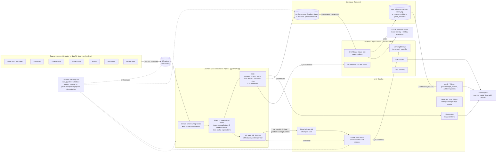

# Architecture: one connected data journey

Larkwell Foods is a fictitious UK food retailer, and all data is synthetic. Every arrow below is a real, running integration
in this build, and `evidence/` shows each one executing.

## The seven stages

| Stage | Product | What it does in this build | Where |
|---|---|---|---|
| Ingest | **Lakeflow** (Spark Declarative Pipelines, Auto Loader, Jobs) | Ingests 10 raw feeds incrementally, types and de-duplicates them, and enforces data-quality expectations. Gold works out every shelf's status and root cause from the raw signals. Six weeks of stock history feed the gap-risk model's features. A daily job orchestrates the whole journey. | `pipeline/`, `resources/` |
| Govern | **Unity Catalog** | One catalog with medallion schemas and volumes. Governed tags include a PII tag on email. Lineage is automatic, the app has least-privilege grants, and a metric view holds the single definition of every KPI. | `governance/` |
| Serve | **Lakebase** | Unity Catalog syncs gold into Postgres, so Shelf Scan answers in a few milliseconds. The app writes actions and telemetry to Postgres, and Lakehouse Sync streams them back to Unity Catalog. | `lakebase/`, `app/lakebase.py` |
| Predict | **Machine learning** (MLflow, Unity Catalog models) | A LightGBM gap-risk model predicts, the day before, which ranged lines will be empty the next morning. It's trained on the pipeline's features, logged to MLflow, and registered in Unity Catalog. Only a version that beats two rules a store could use gets the champion alias. The daily job grades yesterday's predictions, then scores every line for tomorrow, with plain-English reasons. | `ml/`, `pipeline/ml/` |
| Intelligence | **Gen AI** (Model Serving, MLflow) | An LLM words the playbook action for the colleague. It's evaluated with MLflow on 48 real cases, using code checks and LLM judges calibrated against hand-labelled answers, as part of the daily job. | `app/nba.py`, `genai/` |
| Ask | **Genie agent** | Natural-language questions over the metric view, gold and the actions loop. A 12-question benchmark is scored by Genie's evaluation. | `genie/` |
| Act | **Databricks App** | FastAPI with a single-page frontend: dashboards, drill-downs, a morning briefing with tomorrow's watch list, Shelf Scan, actions, Genie chat and a live Data Journey. | `app/` |

## Why it's one journey, not six demos

- The app reads the **same gold table** two ways: from the warehouse for analytics, and from Lakebase for point lookups.
- What a colleague does in the app **comes back** into Unity Catalog (Lakehouse Sync). Genie can then answer "what have stores done about supplier shorts today?"
- The **daily job** runs the stages in order and checks each one against the source manifest and the answer key. It publishes those checks to a table that the app's Data Journey tab reads.
- The **evaluation** tests the exact prompt module the app imports.
- The **gap-risk model** learns from the same pipeline that explains today's gaps, and is graded every morning against them. Training and scoring read one features table, so the two can't drift apart.
